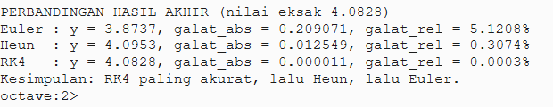
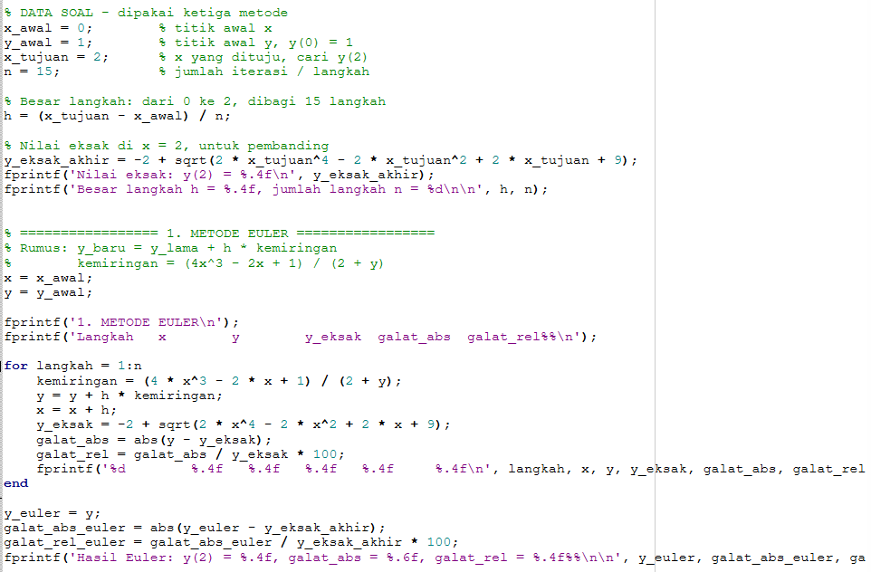
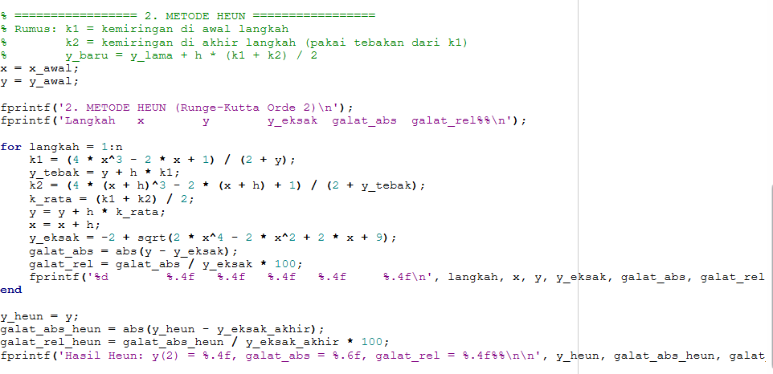
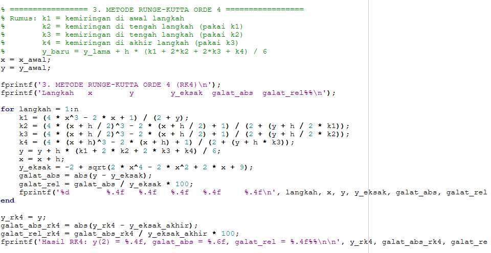
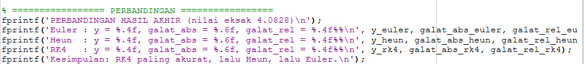
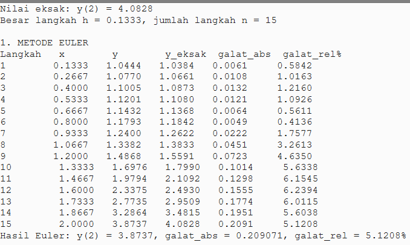
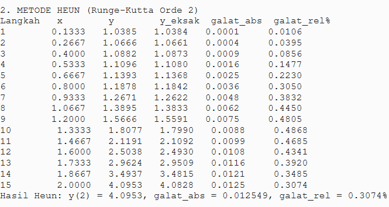
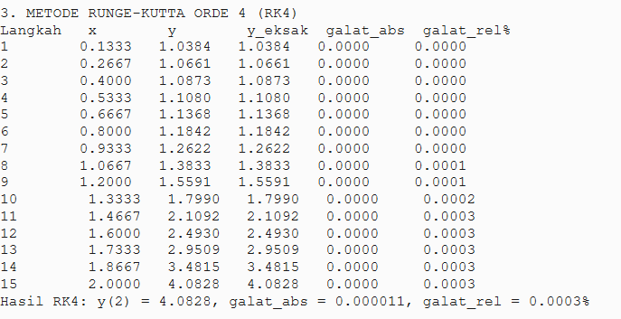

[README (1).md](https://github.com/user-attachments/files/34543884/README.1.md)
# Praktikum 10 – PDB: Penyelesaian Persamaan Diferensial Biasa dengan Metode Euler, Heun, dan Runge-Kutta Orde 4



Program Octave satu file untuk menyelesaikan persamaan diferensial biasa (PDB) `dy/dx = (4x^3 - 2x + 1) / (2 + y)` dengan nilai awal `y(0) = 1` dan mencari `y(2)`, menggunakan Metode Euler, Metode Heun, dan Metode Runge-Kutta Orde 4 (RK4) dengan jumlah iterasi `n = 15`. Hasil tiap metode dibandingkan dengan solusi eksak (analitik) melalui galat absolut dan galat relatif.

## Identitas

| | |
| --- | --- |
| Nama | Agis Lentera Pratama |
| NIM | L0325016 |
| Program Studi | Informatika |
| Fakultas | Fakultas Teknologi Informasi dan Sains Data |
| Universitas | Universitas Sebelas Maret |
| Mata Kuliah | Metode Numerik |
| Praktikum | Praktikum 10 – PDB |
| Bahasa pemrograman | GNU Octave |

## Soal

Dari persamaan di bawah ini:

```
dy/dx = (4x^3 - 2x + 1) / (2 + y)
```

1. Carilah nilai dari `y(2)` apabila diketahui nilai `y(0) = 1` dengan menggunakan metode analitik (eksak), Euler, Heun, dan Runge-Kutta Orde-4. Gunakan jumlah iterasi `n = 15` untuk metode pendekatan.
2. Carilah galat absolut serta galat relatif dari masing-masing pendekatan.

## Solusi Eksak (Analitik)

Persamaan diselesaikan dengan pemisahan variabel:

```
(2 + y) dy = (4x^3 - 2x + 1) dx
2y + y^2/2 = x^4 - x^2 + x + C
```

Nilai awal `y(0) = 1` memberikan `C = 2,5`, sehingga setelah disusun ulang:

```
y = -2 + sqrt(2x^4 - 2x^2 + 2x + 9)
y(2) = -2 + sqrt(37) = 4,0828
```

Nilai eksak `y(2) = 4,0828` inilah yang dipakai sebagai pembanding untuk menghitung galat absolut dan galat relatif ketiga metode pendekatan.

## Isi ZIP

| File | Keterangan |
| --- | --- |
| `README.md` | Berkas ini |
| `PMN10_L0325016_AgisLenteraPratama.m` | Source code Octave, satu file saja |
| `gambar1_kode_data_euler.png` | Screenshot source code: data soal, nilai eksak, dan Metode Euler |
| `gambar2_kode_heun.png` | Screenshot source code: Metode Heun |
| `gambar3_kode_rk4.png` | Screenshot source code: Metode Runge-Kutta Orde 4 |
| `gambar4_kode_perbandingan.png` | Screenshot source code: perbandingan hasil akhir |
| `gambar5_hasil_euler.png` | Screenshot hasil: Metode Euler |
| `gambar6_hasil_heun.png` | Screenshot hasil: Metode Heun |
| `gambar7_hasil_rk4.png` | Screenshot hasil: Metode Runge-Kutta Orde 4 |
| `gambar8_hasil_perbandingan.png` | Screenshot hasil: perbandingan hasil akhir |

## Cara Menjalankan

1. Pastikan GNU Octave sudah terpasang.
2. Buka folder hasil ekstrak ZIP ini di Octave (atau buka file `PMN10_L0325016_AgisLenteraPratama.m` di editor Octave).
3. Jalankan dengan mengetik nama file di Command Window (tanpa `.m`):

```
PMN10_L0325016_AgisLenteraPratama
```

atau tekan tombol Run (F5) dari editor.

4. Hasilnya tampil sebagai tulisan di Command Window: nilai eksak, tabel per langkah untuk tiap metode, lalu perbandingan hasil akhir. Program tidak memakai figure atau grafik.

## Source Code

Data soal ditulis sekali di bagian atas program, yaitu `x_awal = 0`, `y_awal = 1`, `x_tujuan = 2`, dan `n = 15`, lalu dipakai bersama oleh ketiga metode. Besar langkahnya adalah `h = (x_tujuan - x_awal) / n = (2 - 0) / 15 = 0,1333`. Tiap metode mengembalikan `x` dan `y` ke nilai awal sebelum loop-nya berjalan, supaya hasil tiap metode tidak tercampur.

### Data Soal dan Metode Euler



Bagian awal program menghitung besar langkah `h` dan nilai eksak di `x = 2` (`y_eksak_akhir`), lalu menjalankan Metode Euler. Di setiap langkah, kemiringan dihitung dengan `kemiringan = (4 * x^3 - 2 * x + 1) / (2 + y)`, lalu `y` maju satu langkah dengan `y = y + h * kemiringan` dan `x` maju dengan `x = x + h`. Setelah maju, program menghitung nilai eksak pada `x` yang baru, galat absolut, dan galat relatif, lalu mencetak satu baris tabel. Sebagai contoh, pada langkah pertama kemiringan di titik (0, 1) adalah `1/3 = 0,3333`, sehingga `y` menjadi `1,0444` pada `x = 0,1333`. Nilai `y` terakhir disimpan sebagai `y_euler`, dengan galat absolut dicetak sampai enam angka di belakang koma.

### Metode Heun



Metode Heun, yang juga disebut Runge-Kutta Orde 2, memakai dua kemiringan dalam satu langkah. `k1` adalah kemiringan di awal langkah, lalu dibuat tebakan `y_tebak = y + h * k1` dan kemiringan kedua `k2` dihitung di ujung langkah (`x + h`) dengan `y_tebak` itu. Kedua kemiringan dirata-rata menjadi `k_rata = (k1 + k2) / 2`, dan `y` baru dihitung dengan `y = y + h * k_rata`. Dengan cara ini kemiringan yang dipakai sudah dikoreksi oleh kemiringan di ujung langkah. Hitungan tangan langkah pertama: `k1 = 0,3333`, `y_tebak = 1,0444`, `k2 = 0,2440`, `k_rata = 0,2887`, sehingga `y = 1,0385`, persis sama dengan baris pertama pada tabel hasil Heun.

### Metode Runge-Kutta Orde 4



Metode Runge-Kutta Orde 4 (RK4) memakai empat kemiringan dalam satu langkah: `k1` di awal langkah, `k2` di tengah langkah (`x + h/2`, memakai `k1`), `k3` di tengah langkah (memakai `k2`), dan `k4` di akhir langkah (`x + h`, memakai `k3`). Keempatnya digabung dengan rata-rata berbobot `y = y + h * (k1 + 2*k2 + 2*k3 + k4) / 6`, di mana angka 2 di depan `k2` dan `k3` berarti kemiringan di tengah langkah dihitung dua kali lipat karena paling mewakili keadaan selama langkah itu. Hitungan tangan langkah pertama: `k1 = 0,3333`, `k2 = 0,2872`, `k3 = 0,2874`, `k4 = 0,2445`, rata-rata berbobot `0,2878`, sehingga `y = 1,0384`, persis sama dengan baris pertama pada tabel hasil RK4.

### Perbandingan Hasil



Bagian terakhir program mencetak nilai `y(2)`, galat absolut, dan galat relatif untuk Euler, Heun, dan RK4, dengan nilai eksak `4,0828` sebagai pembanding. Galat absolut dicetak dengan format `%.6f` (enam angka di belakang koma) supaya galat RK4 yang sebesar `0,000011` tetap terbaca dan tidak tertutup pembulatan empat desimal seperti pada tabel per langkah. Galat relatif dicetak dalam persen dengan empat angka di belakang koma.

## Hasil

### Metode Euler



Nilai `y` hasil Euler naik dari `1,0444` pada langkah pertama menjadi `3,8737` pada langkah ke-15, sedangkan nilai eksaknya naik dari `1,0384` menjadi `4,0828`. Pada lima langkah pertama `y` hasil Euler sedikit di atas nilai eksak, lalu mulai langkah ke-6 berada di bawah nilai eksak dan selisihnya terus membesar sampai `0,2091` pada langkah terakhir, dengan galat relatif akhir `5,1208%`. Euler hanya memakai kemiringan di awal langkah, sehingga ketika kurva menanjak tajam setelah `x` sekitar `0,9`, kemiringan awal selalu tertinggal dan galatnya menumpuk. Hasil akhir: `y(2) = 3,8737`, galat absolut `0,209071`, galat relatif `5,1208%`.

### Metode Heun



Nilai `y` hasil Heun naik dari `1,0385` pada langkah pertama menjadi `4,0953` pada langkah ke-15, dan pada semua langkah nilainya sedikit di atas nilai eksak. Galat absolutnya naik perlahan dari `0,0001` menjadi `0,0125`, dengan galat relatif akhir `0,3074%`. Galat Heun pada langkah terakhir hanya sekitar seperenam belas dari galat Euler, karena rata-rata `k1` dan `k2` sudah memperhitungkan perubahan kemiringan selama satu langkah. Hasil akhir: `y(2) = 4,0953`, galat absolut `0,012549`, galat relatif `0,3074%`.

### Metode Runge-Kutta Orde 4



Nilai `y` hasil RK4 sama dengan nilai eksak sampai empat angka di belakang koma pada semua langkah, dari `1,0384` sampai `4,0828`. Galat absolut pada tabel per langkah tampil sebagai `0,0000` karena pembulatan empat desimal, sedangkan nilai sebenarnya baru terlihat pada baris hasil akhir, yaitu galat absolut `0,000011` dan galat relatif `0,0003%`. Empat kemiringan berbobot pada RK4 hampir sepenuhnya menangkap kelengkungan kurva selama satu langkah, sehingga galatnya praktis tidak menumpuk. Hasil akhir: `y(2) = 4,0828`, galat absolut `0,000011`, galat relatif `0,0003%`.

### Perbandingan Ketiga Metode


| Metode | y(2) | Galat Absolut | Galat Relatif |
| --- | --- | --- | --- |
| Euler | 3,8737 | 0,209071 | 5,1208% |
| Heun | 4,0953 | 0,012549 | 0,3074% |
| RK4 | 4,0828 | 0,000011 | 0,0003% |
| **Eksak** | **4,0828** | – | – |

Urutan ketelitiannya jelas: RK4 paling akurat, lalu Heun, lalu Euler. Galat absolut Euler sekitar 16,7 kali galat Heun, dan galat Heun sekitar 1141 kali galat RK4, meskipun ketiganya memakai jumlah langkah yang sama (`n = 15`, `h = 0,1333`). Hal ini sesuai dengan teori: Euler memakai satu kemiringan, Heun memakai dua kemiringan yang dirata-rata, dan RK4 memakai empat kemiringan berbobot, sehingga semakin banyak informasi kemiringan yang dipakai dalam satu langkah, semakin kecil galatnya.

## Kesimpulan

- Nilai eksak `y(2) = 4,0828`.
- Metode Euler memberikan `y(2) = 3,8737` dengan galat absolut `0,209071` dan galat relatif `5,1208%`. Paling sederhana, tetapi galatnya paling besar.
- Metode Heun memberikan `y(2) = 4,0953` dengan galat absolut `0,012549` dan galat relatif `0,3074%`. Jalan tengah yang baik: kodenya hanya sedikit lebih panjang daripada Euler, tetapi ketelitiannya sudah jauh lebih baik.
- Metode Runge-Kutta Orde 4 memberikan `y(2) = 4,0828` dengan galat absolut `0,000011` dan galat relatif `0,0003%`. Paling akurat dan pilihan yang tepat bila ketelitian menjadi prioritas utama.

## Catatan

- Galat RK4 pada tabel per langkah tampil sebagai `0,0000` karena tabel dicetak dengan empat angka di belakang koma; nilai galat yang sebenarnya (`0,000011`) hanya terbaca pada baris hasil akhir yang dicetak dengan enam angka di belakang koma.
- Semua galat yang dilaporkan berlaku untuk `n = 15` dengan `h = 0,1333`; bila `n` diubah, galat ketiga metode akan berubah.
- Screenshot pada README ini adalah hasil run asli program di GNU Octave.
- Laporan praktikum lengkap (analisis source code dan analisis hasil yang diperpanjang, beserta kesimpulan) ada di berkas terpisah.

## Lampiran: Source Code Lengkap

Isi lengkap file `PMN10_L0325016_AgisLenteraPratama.m` (sama persis dengan file di dalam ZIP ini):

```octave
% PMN10 - PDB: dy/dx = (4x^3 - 2x + 1) / (2 + y), cari y(2)
% Isi file ini: Eksak, Euler, Heun, dan Runge-Kutta Orde 4, dalam 1 file.
% Tanpa figure, tanpa grafik. Hasilnya hanya tulisan di Command Window.
%
% Cara menjelaskan saat presentasi:
%   - Data soal ditulis sekali di atas, dipakai ketiga metode.
%   - Tiap metode diulang 15 langkah dengan loop for.
%   - Euler : 1 kemiringan, langsung maju.
%   - Heun  : 2 kemiringan, dirata-rata.
%   - RK4   : 4 kemiringan, rata-rata berbobot.
%   - Di akhir ada tabel perbandingan ketiganya.
%
% SOLUSI EKSAK (analitik, hitungan tangan):
%   (2 + y) dy = (4x^3 - 2x + 1) dx
%   2y + y^2/2 = x^4 - x^2 + x + C
%   y(0) = 1  ->  C = 2.5
%   y = -2 + sqrt(2x^4 - 2x^2 + 2x + 9)
%   y(2) = -2 + sqrt(37) = 4.0828

clear; clc;

% DATA SOAL - dipakai ketiga metode
x_awal = 0;        % titik awal x
y_awal = 1;        % titik awal y, y(0) = 1
x_tujuan = 2;      % x yang dituju, cari y(2)
n = 15;            % jumlah iterasi / langkah

% Besar langkah: dari 0 ke 2, dibagi 15 langkah
h = (x_tujuan - x_awal) / n;

% Nilai eksak di x = 2, untuk pembanding
y_eksak_akhir = -2 + sqrt(2 * x_tujuan^4 - 2 * x_tujuan^2 + 2 * x_tujuan + 9);
fprintf('Nilai eksak: y(2) = %.4f\n', y_eksak_akhir);
fprintf('Besar langkah h = %.4f, jumlah langkah n = %d\n\n', h, n);


% ================= 1. METODE EULER =================
% Rumus: y_baru = y_lama + h * kemiringan
%        kemiringan = (4x^3 - 2x + 1) / (2 + y)
x = x_awal;
y = y_awal;

fprintf('1. METODE EULER\n');
fprintf('Langkah   x        y        y_eksak  galat_abs  galat_rel%%\n');

for langkah = 1:n
    % Hitung kemiringan di titik sekarang
    kemiringan = (4 * x^3 - 2 * x + 1) / (2 + y);

    % Maju satu langkah
    y = y + h * kemiringan;
    x = x + h;

    % Nilai eksaknya, untuk pembanding saja
    y_eksak = -2 + sqrt(2 * x^4 - 2 * x^2 + 2 * x + 9);
    galat_abs = abs(y - y_eksak);
    galat_rel = galat_abs / y_eksak * 100;

    % %.4f artinya: tampilkan 4 angka di belakang koma
    fprintf('%d        %.4f   %.4f   %.4f   %.4f     %.4f\n', langkah, x, y, y_eksak, galat_abs, galat_rel);
end

% Simpan hasil akhirnya, untuk perbandingan di bawah
y_euler = y;
galat_abs_euler = abs(y_euler - y_eksak_akhir);
galat_rel_euler = galat_abs_euler / y_eksak_akhir * 100;
fprintf('Hasil Euler: y(2) = %.4f, galat_abs = %.6f, galat_rel = %.4f%%\n\n', y_euler, galat_abs_euler, galat_rel_euler);


% ================= 2. METODE HEUN =================
% Rumus: k1 = kemiringan di awal langkah
%        k2 = kemiringan di akhir langkah (pakai tebakan dari k1)
%        y_baru = y_lama + h * (k1 + k2) / 2
x = x_awal;
y = y_awal;

fprintf('2. METODE HEUN (Runge-Kutta Orde 2)\n');
fprintf('Langkah   x        y        y_eksak  galat_abs  galat_rel%%\n');

for langkah = 1:n
    % Kemiringan pertama: di titik sekarang
    k1 = (4 * x^3 - 2 * x + 1) / (2 + y);

    % Tebak dulu y di ujung langkah, pakai k1
    y_tebak = y + h * k1;

    % Kemiringan kedua: di ujung langkah
    k2 = (4 * (x + h)^3 - 2 * (x + h) + 1) / (2 + y_tebak);

    % Rata-rata kedua kemiringan, baru maju satu langkah
    k_rata = (k1 + k2) / 2;
    y = y + h * k_rata;
    x = x + h;

    % Nilai eksaknya, untuk pembanding saja
    y_eksak = -2 + sqrt(2 * x^4 - 2 * x^2 + 2 * x + 9);
    galat_abs = abs(y - y_eksak);
    galat_rel = galat_abs / y_eksak * 100;

    fprintf('%d        %.4f   %.4f   %.4f   %.4f     %.4f\n', langkah, x, y, y_eksak, galat_abs, galat_rel);
end

% Simpan hasil akhirnya, untuk perbandingan di bawah
y_heun = y;
galat_abs_heun = abs(y_heun - y_eksak_akhir);
galat_rel_heun = galat_abs_heun / y_eksak_akhir * 100;
fprintf('Hasil Heun: y(2) = %.4f, galat_abs = %.6f, galat_rel = %.4f%%\n\n', y_heun, galat_abs_heun, galat_rel_heun);


% ================= 3. METODE RUNGE-KUTTA ORDE 4 =================
% Rumus: k1 = kemiringan di awal langkah
%        k2 = kemiringan di tengah langkah (pakai k1)
%        k3 = kemiringan di tengah langkah (pakai k2)
%        k4 = kemiringan di akhir langkah (pakai k3)
%        y_baru = y_lama + h * (k1 + 2*k2 + 2*k3 + k4) / 6
% Angka 2 di depan k2 dan k3 artinya kemiringan tengah
% dihitung dua kali lipat, karena paling mewakili langkah itu.
x = x_awal;
y = y_awal;

fprintf('3. METODE RUNGE-KUTTA ORDE 4 (RK4)\n');
fprintf('Langkah   x        y        y_eksak  galat_abs  galat_rel%%\n');

for langkah = 1:n
    % k1: kemiringan di awal langkah
    k1 = (4 * x^3 - 2 * x + 1) / (2 + y);

    % k2: kemiringan di tengah langkah, pakai k1
    k2 = (4 * (x + h / 2)^3 - 2 * (x + h / 2) + 1) / (2 + (y + h / 2 * k1));

    % k3: kemiringan di tengah langkah, pakai k2
    k3 = (4 * (x + h / 2)^3 - 2 * (x + h / 2) + 1) / (2 + (y + h / 2 * k2));

    % k4: kemiringan di akhir langkah, pakai k3
    k4 = (4 * (x + h)^3 - 2 * (x + h) + 1) / (2 + (y + h * k3));

    % Rata-rata berbobot, baru maju satu langkah
    y = y + h * (k1 + 2 * k2 + 2 * k3 + k4) / 6;
    x = x + h;

    % Nilai eksaknya, untuk pembanding saja
    y_eksak = -2 + sqrt(2 * x^4 - 2 * x^2 + 2 * x + 9);
    galat_abs = abs(y - y_eksak);
    galat_rel = galat_abs / y_eksak * 100;

    fprintf('%d        %.4f   %.4f   %.4f   %.4f     %.4f\n', langkah, x, y, y_eksak, galat_abs, galat_rel);
end

% Simpan hasil akhirnya, untuk perbandingan di bawah
y_rk4 = y;
galat_abs_rk4 = abs(y_rk4 - y_eksak_akhir);
galat_rel_rk4 = galat_abs_rk4 / y_eksak_akhir * 100;
fprintf('Hasil RK4: y(2) = %.4f, galat_abs = %.6f, galat_rel = %.4f%%\n\n', y_rk4, galat_abs_rk4, galat_rel_rk4);


% ================= PERBANDINGAN =================
fprintf('PERBANDINGAN HASIL AKHIR (nilai eksak 4.0828)\n');
fprintf('Euler : y = %.4f, galat_abs = %.6f, galat_rel = %.4f%%\n', y_euler, galat_abs_euler, galat_rel_euler);
fprintf('Heun  : y = %.4f, galat_abs = %.6f, galat_rel = %.4f%%\n', y_heun, galat_abs_heun, galat_rel_heun);
fprintf('RK4   : y = %.4f, galat_abs = %.6f, galat_rel = %.4f%%\n', y_rk4, galat_abs_rk4, galat_rel_rk4);
fprintf('Kesimpulan: RK4 paling akurat, lalu Heun, lalu Euler.\n');
```
